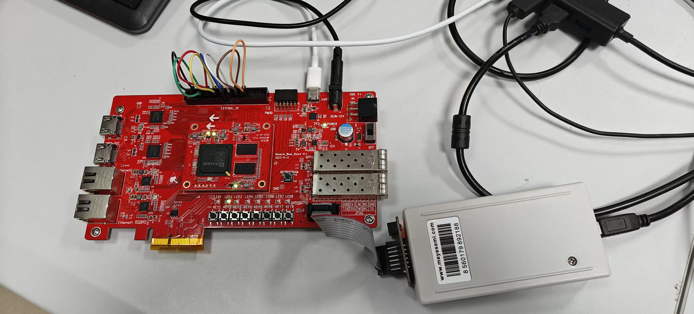

# RISC-V 多协议逻辑分析仪

[](./LICENSE)
[](./LICENSE-hardware-CERN-OHL-P-2.0.txt)
[](https://h2co3cumt.github.io/works/riscv-logic-analyzer/)

项目主页：<https://h2co3cumt.github.io/works/riscv-logic-analyzer/>



在**一片**紫光同创 PGL50H-6IFBG484 上，同时实现一个自研的 RV32I 五级流水处理器和一个八通道逻辑分析仪——被测对象和观测工具是同一颗芯片。

2026 全国大学生 FPGA 创新设计大赛 参赛作品。

## 为什么做成一颗芯片

板级故障里最难查的一类，是"读代码能读通、上板却不通"。串口偶发丢帧、SPI 时序偏斜这类问题，静态测量复现不了，只能把真实波形抓下来看。商用逻辑分析仪不是不好用，是通道数和协议解析方式固定，按现场需要裁剪不了。

把采集器做到 FPGA 内部，好处是采集源可以切到处理器内部观测点：不只看引脚电平，而是直接看取指、提交、停顿、冲刷发生在哪个周期。

## 结构

```text
rtl/                       36 个 RTL 模块
├─ pipeline_cpu.v          RV32I 五级流水（IF/ID/EX/MEM/WB）+ 数据前递、Load-Use 停顿、分支冲刷
├─ single_cycle_cpu.v      单周期参考模型，验证时用来逐条比对提交序列
├─ branch_predictor.v      16 项 BTB + 2-bit 饱和计数器
├─ mdu.v                   M 扩展：mul / mulh / mulhsu / mulhu / div / divu / rem / remu
├─ csr_unit.v              机器模式 CSR 与精确 Trap（M-01 ~ M-24 验收条目）
├─ soc_icache_2way.v       两路组相联 I-Cache（默认关闭，见下）
├─ soc_dcache_2way.v       两路组相联 D-Cache（默认关闭，见下）
├─ soc_line_burst_adapter.v 行式突发适配（保留）
├─ logic_analyzer_*.v      采集引擎、Trace Buffer、MMIO 接口
├─ perf_monitor.v / perf_mmio.v  CPI 与分支冲刷计数
└─ uart_* / gpio_mmio / timer_mmio / soc_data_interconnect
tb/                        93 个 testbench
docs/                      设计说明与验收记录
scripts/                   构建、审计与回归脚本
python/                    上位机采集与 CoreMark CPI 分析
fpga/                      PDS 工程（综合/布局布线产物不入库）
release/                   交付清单与板级验证包
```

## 两个被实测否掉的方案

**I-Cache 和 D-Cache 功能正确，但都关闭了。** 两路组相联接进去之后，CoreMark 执行周期分别涨到 2,891,324 和 1,348,302，比不开还慢——这套负载访存不密集，命中收益抵不过额外的时序路径和状态机开销。按事先定好的取舍条件关闭，也不计入性能数据。

**行式突发保留。** 同一段访问的总线周期从 48 降到 30，是净收益。

## 指标

两组数据分属两个工程，不能合并引用。

| | 整机位流（分析仪应用） | 计分位流（rv32i / rv32im） |
| --- | --- | --- |
| 工作频率 | 85.000 MHz | 85 MHz |
| 逻辑资源 | 4,995 LUT / 3,907 FF | 4,198 LUT / 3,361 FF |
| 存储与乘法器 | 6.0 DRM / 4 APM | — |
| Setup WNS | +0.577 ns | +0.250 ns |
| 估算 Fmax | 89.3841 MHz | 86.8456 MHz |
| CoreMark | — | 79.587 / 193.192 |
| CoreMark/MHz | — | 0.936 / 2.272 |
| CoreMark/LUT | — | 0.0190 / 0.0460 |

85 MHz 整机位流上完成五种模式各 20 次、共 100 次板级采集，全部通过。

## 怎么验证

需要：

- 紫光同创 PDS（综合与布局布线）
- ModelSim（RTL 仿真）

```bash
# 仿真：单周期参考模型与流水线模型的提交序列逐条比对
#   差异时定位到第一条不一致的提交，不用等程序跑完再比最终状态
python python/coremark_cpi_analysis.py     # CoreMark CPI 与冲刷统计

# 综合与实现：各 PDS 阶段由脚本重建，构建产物不入库
#   见 scripts/ 与 fpga/ 下的 pds_recipe.tcl
```

`tests/regression_matrix.md` 是回归矩阵。机器模式异常与中断按 M-01 至 M-24 共 24 条验收条目完成，99 条独立断言全部通过。

## 许可

- **代码**（`rtl/`、`tb/`、`scripts/`、`python/` 等）：[MIT](./LICENSE)
- **硬件设计文档与约束**（`docs/`、`fpga/` 下的 `.fdc` 与工程描述、`release/` 中的设计资料）：[CERN-OHL-P-2.0](./LICENSE-hardware-CERN-OHL-P-2.0.txt)

简单说：代码随便用，改硬件设计并再分发时请保留许可与出处。

## 已知边界

- 逻辑分析仪采集深度为 2048 样本 Raw 缓存，协议解析只覆盖 UART 与 SPI。
- 文中两组指标分属两个工程（整机位流与计分位流），不可合并引用。
- 板级验证是在 85 MHz 整机位流上做的，换频率或换器件需要重新做时序与采集回归。
