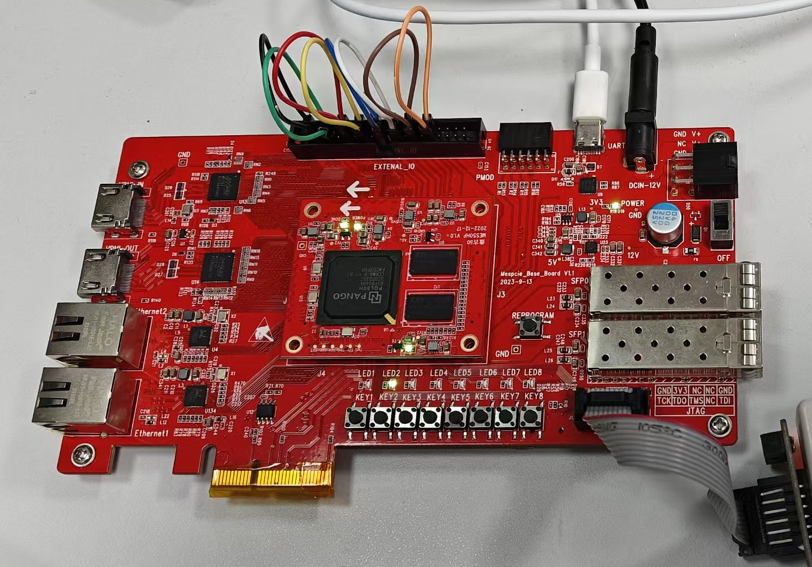
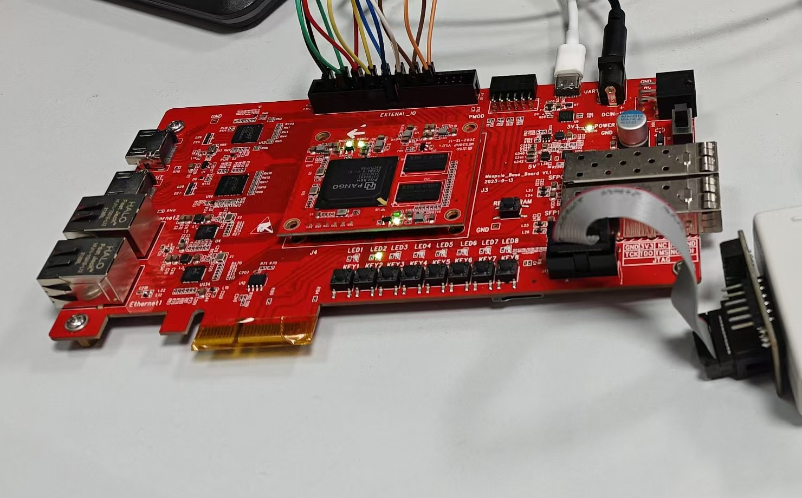
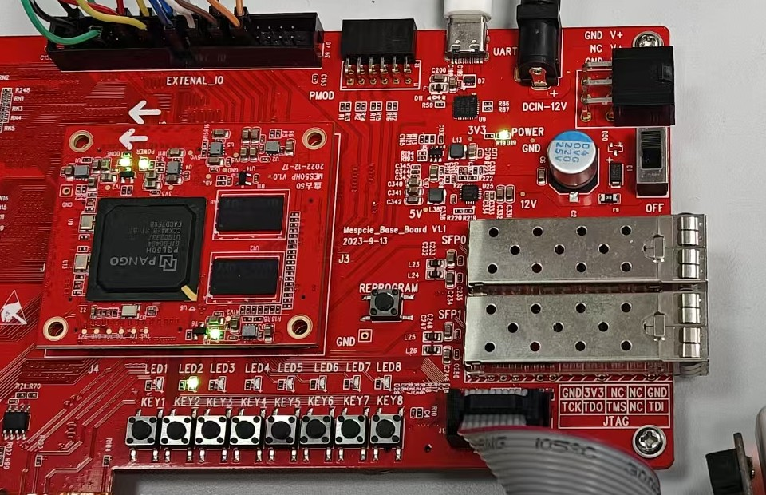

# RISC-V 多协议逻辑分析仪

---

## 摘要

写板级故障时，串口或 SPI 通信异常往往读代码能读通、上板却不通，必须在真实波形上找原因；商用逻辑分析仪的通道数与协议解析方式固定，不便按现场需要裁剪。本作品在一片紫光同创 PGL50H-6IFBG484 上同时实现自主设计的 RISC-V 处理器与八通道逻辑分析仪，用同一颗器件完成被测对象的运行与观测。

处理器执行完整 RV32I 整数指令集，采用 IF、ID、EX、MEM、WB 五级流水，实现数据前递、Load-Use 停顿与分支跳转冲刷。控制流使用 16 项 BTB 配合 2-bit 饱和计数器，RTL 仿真中 CoreMark 执行周期由 1,604,264 降到 1,251,724，分支冲刷由 161,742 次降到 69,120 次，CPI 由 2.0670 降到 1.5907。M 扩展的八条乘除指令作为并列配置实现，rv32i 与 rv32im 两套镜像独立构建。机器模式 CSR 与精确 Trap 按 M-01 至 M-24 共 24 条验收条目完成，99 条独立断言全部通过。

整机位流工作在 85 MHz，PDS 时序分析为 All Constraints Met。计分位流在同一频率上给出两组结果：rv32i 配置 CoreMark 分数 79.587、CoreMark/MHz 0.936；rv32im 配置分数 193.192、CoreMark/MHz 2.272。两组使用同一份 RTL 与相同资源占用，CoreMark/LUT 由 0.0190 提高到 0.0460。

逻辑分析仪位于处理器核外部，经统一 MMIO 接入，提供 8 通道采集、电平与边沿触发、触发前后采样、2048 样本 Raw 缓存，以及 UART 与 SPI 协议解析和边沿数、频率、周期抖动、占空比读数。采集源可选 J8 外部引脚或处理器内部观测点，两条来源共用同一条采集链路。85 MHz 整机位流上完成五种模式各 20 次、共 100 次板级采集，全部通过。

处理器与外设之间只经统一取指事务、数据事务与提交事件连接，更换或增加外设不改变流水线源文件。文中每个数字都对应到具体的位流与实测记录；拿不到可复现数据的项目不作引用。

**关键词**：RISC-V；五级流水线；分支预测；精确异常；逻辑分析仪；紫光同创 FPGA

---

## 第一部分　作品概述

### 1.1 功能与特性

处理器执行完整 RV32I 基础整数指令集，覆盖算术、逻辑、移位、分支、跳转、load/store、fence 与 ecall、ebreak。流水线为 IF、ID、EX、MEM、WB 五级，数据前递同时取用 EX/MEM 与 MEM/WB 两级结果，Load-Use 冲突插入一拍停顿，分支与跳转在解析后冲刷错误路径。

控制流使用 16 项 BTB 与 2-bit 饱和计数器，预测信息随指令流过流水线，在 EX 级复核方向与目标，误预测时冲刷并按真实目标重定向。M 扩展实现 mul、mulh、mulhsu、mulhu、div、divu、rem、remu 八条指令，rv32i 与 rv32im 两套镜像独立构建。

机器模式异常与中断已实现，包含 CSR 读写、mtvec、mepc、mcause、mtval、mstatus 与 MRET，中断输入为 software、timer、external 三根通用信号，中断源与优先级全部位于核外。

SoC 侧集成数据 RAM、UART、GPIO 与 MMIO 互连，UART 经板载 CP2102 与上位机通信，帧格式 115200 8N1。逻辑分析仪提供 8 通道采集、电平与边沿触发、触发前后采样、2048 样本 Raw 缓存、UART 与 SPI 协议解析，以及每通道的边沿数、频率、周期抖动与占空比读数。

### 1.2 应用领域

本作品面向嵌入式板级信号的观测与故障定位。现场调试中，SPI 或 UART 通信异常常表现为偶发丢帧或时序偏斜，读代码看不出问题，静态测量也复现不了，只有把真实波形抓下来才能判断是协议实现错误还是信号完整性问题。

商用逻辑分析仪的通道数与协议解析固定，不便按现场需要裁剪；本作品用一片 FPGA 同时承担被测程序运行与信号采集，采集源有两路。一路接 J8 扩展引脚，用于观测板上任意数字信号；另一路接处理器内部观测点，直接观察取指、提交、停顿与冲刷事件发生在哪些周期，而不只是读到性能计数器的汇总值。

第二类场景是 RISC-V 微架构教学。单周期参考模型与五级流水模型对同一程序产生一致的架构状态与提交序列，提交级 trace 可逐条比对，用来说明前递、停顿与冲刷具体出现在哪一条指令上。

采集、触发、存储与回传全部在处理器核外部完成，更换被测协议或增加通道不需要改动流水线。

### 1.3 主要技术特点

处理器核与 SoC 严格解耦。核只通过统一取指事务、数据事务与提交事件对外连接，RAM、UART、GPIO 与逻辑分析仪都在核外。更换或新增外设时，核的源文件与核级回归保持不变。

验证以单周期处理器作参考模型。同一程序在两套实现上产生相同的架构状态与提交序列，出现差异时定位到第一条不一致的提交，无需等程序结束再比最终状态。

异常在退休边界被接受。检测级只登记异常，mepc 与 mtval 由退休级给出，被冲刷的指令不产生架构副作用，同拍到来的中断不取消已经提交的指令。

存储层次的取舍由实测决定。两路组相联 I-Cache 与 D-Cache 功能正确，但接入后执行周期分别涨到 2,891,324 与 1,348,302，按事先定好的取舍条件关闭，不计入性能数据；行式突发把同一段访问的总线周期从 48 降到 30，予以保留。

自研采集工具可自证。板载八通道采集直接观测自研处理器的提交级行为，4096 条记录的指令字与位流镜像逐条一致，说明观测链路本身没有引入失真。

### 1.4 主要性能指标

整机位流为逻辑分析仪应用，工作频率 85.000 MHz，PDS 时序分析结论为 All Constraints Met。CoreMark 计分使用另一颗位流，同频 85 MHz，rv32i 与 rv32im 两组配置各自独立构建。表 1-1 与表 1-2 分属两个工程，指标不可合并引用。

**表 1-1　整机位流（逻辑分析仪应用，85 MHz）**

| 指标 | 数值 | 依据 |
|---|---|---|
| 工作频率 | 85.000 MHz | PDS 时序报告 |
| 逻辑资源 | 4,995 LUT / 3,907 FF | 布局布线后资源报告 |
| 块存储与乘法器 | 6.0 DRM / 4 APM | 同上 |
| Setup WNS / Hold WHS | +0.577 ns / +0.308 ns | 布线后时序报告 |
| 估算 Fmax | 89.3841 MHz（PDS 静态分析值，非实测） | 同上 |
| 位流 SHA-256 | `C017ED10…FA4F` | 三处副本一致，已下载到板上验证 |
| 板级采集验收 | 五模式各 20 次，100/100 PASS | 板级验收记录 |

**表 1-2　CoreMark 计分配置（85 MHz，同源同 RTL）**

| 指标 | rv32i 配置 | rv32im 配置 |
|---|---|---|
| CoreMark 分数 | 79.587 | 193.192 |
| CoreMark/MHz | 0.936 | 2.272 |
| 逻辑资源 | 4,198 LUT / 3,361 FF | 4,198 LUT / 3,361 FF |
| Setup WNS | +0.250 ns | +0.250 ns |
| 估算 Fmax | 86.8456 MHz | 86.8456 MHz |
| CoreMark/LUT | 0.0190 | 0.0460 |

> 表 1-1 的数字取自该位流自己的布局布线与时序报告：资源按 LUT as Logic 统计（CLMA 3,096 加 CLMS 1,899），时序取布线后的 Slack，全部约束满足。三处位流副本的 SHA-256 一致，并于 2026-10-27 重新下载到板上复核，配置成功、done 位为 1。

### 1.5 主要创新点

1. 采集源双选。外部引脚与处理器内部观测点共用同一条采集链路与同一套解析接口，切换只改解释口径，不改流水线与核的端口。
2. 双模型等价验证。以固定的单周期处理器作参考模型，按退休顺序比对提交级 trace，差异定位到第一条不一致的提交。
3. 数据决定取舍。存储层次与突发适配都按 Before/After 数据判定去留，Cache 关闭是实测结论而非功能缺失。
4. 中断与 Trap 在核外聚合。核内只有三根通用中断输入，没有设备名、设备地址或设备状态机。

### 1.6 设计流程

设计按八个阶段推进，每一阶段设进入条件与验收条件，未通过验证不进入下一阶段。前四阶段建立可回退的参考基线：先确定赛题指标与范围，再完成单周期 RV32I 参考模型并固定提交序列，随后建立 SoC 与 MMIO 边界，最后完成五级流水与冒险处理并跑通等价性回归。

后四阶段由数据驱动：加入性能计数器与 CoreMark 测量，取得优化前后的对照数据；完成 PDS 时序收敛并上板实测；打通八通道采集应用闭环；最后整理验证记录与提交材料。增强项是否保留，一律以 Before/After 数据判定。

**图 1-1　设计流程图**

---

## 第二部分　系统组成及功能说明

### 2.1 整体介绍

系统由三部分构成：处理器核、片上 SoC，以及位于核外的采集应用。三者之间只有两条数据通路和一条事件通路，模块之间的边界按事务归属划分。

处理器核内部包含取指、译码、执行、访存、写回五级，以及分支预测、冒险判定、前递、乘除单元与 CSR。它对外的全部表述是：一条取指事务、一条数据事务、一组提交与性能事件，加上三根通用中断输入。核不知道 RAM 有多大，不知道 UART 是否存在，也不知道采集逻辑分析仪在观测它。

片上 SoC 承担地址译码与背压。取指地址送往程序存储器，数据事务经互连分发到数据 RAM、UART、GPIO、定时器与应用 MMIO 复用器；任一从设备拉低 ready，核就在对应事务上等待，等待期间不推进后续指令，也不产生提交事件。

采集应用挂在应用 MMIO 复用器之后，由性能监视器与八通道逻辑分析仪组成。性能监视器把核发出的提交事件累计成周期数、退休指令数、停顿数、冲刷次数等读数；逻辑分析仪把 J8 引脚或核内观测点上的 8 路信号按采样间隔写入 2048 样本缓存，再由上位机逐条回读。

三者的关系可以概括为：核只负责算，互连只负责转发与背压，采集只在旁边看。任何设备专用逻辑都不得越过这条边界进入核内。

**图 2-1　系统整体框图**

### 2.2 硬件系统介绍

#### 2.2.1 硬件整体介绍

目标平台为盘古 50（MES50HP）开发板，主器件是紫光同创 Logos 系列 PGL50H-6IFBG484，片上资源为 42,800 个 LUT6、64,200 个触发器、134 块 18 Kbit DRM、84 个 APM。板载 50 MHz 有源晶振接入 P20，经片上 PLL 倍频到 85 MHz 作为系统时钟；另有 27 MHz 与 125 MHz 差分备用时钟，本届未启用。

板载 CP2102 提供 USB 转串口，FPGA 侧接收为 R8、发送为 R9，全部 3.3 V 电平。8 个用户按键低电平有效（K18、L15、J17、K16、J16、J19、H20、H17），8 个用户 LED 高电平点亮（B2、A2、B3、A3、C5、A5、F7、F8）。40 针 J8 扩展口提供 34 路 3.3 V 通用 I/O，本届逻辑分析仪的采集与激励固定占用八组隔行相邻脚对。复位默认由顶层内部上电产生，底板 REST 经延时复位芯片接专用 RSTN，用于重新加载固件，不作为普通用户 I/O。

**图 2-2　硬件整体框图**

#### 2.2.2 机械设计介绍

本作品为板卡级方案，无自研机械结构，不使用 CAD 建模或装配图；板卡固定方式与接口引出沿用开发板原厂形态。

#### 2.2.3 电路各模块介绍

电路层面按供电、配置、时钟、串行通信、扩展接口与人机接口六部分说明，关键输入输出信号线标注见图 2-3。

供电部分由 12 V 直流输入进入板卡，稳压后供 3.3 V 器件使用。配置部分经板载 USB 下载器接 FPGA 的 JTAG 链，用于位流加载；本届未固化到 SPI Flash，掉电后需重新下载。

时钟部分是电路里最需要谨慎的一处：50 MHz 晶振从 P20 进入，经片上 PLL 以整数分频比生成 85.000 MHz。之所以选整数比，是因为非整数会产生不可忽略的抖动，而 CoreMark 的计时按实际频率换算，抖动会直接体现在分数上。

串行通信部分把 FPGA 的 UART 收发接到板载 CP2102，再由 USB 线连到上位机。RX 为 R8、TX 为 R9，电平 3.3 V，帧格式 115200 8N1。这条链路同时承担三重职责：程序输出、性能读数回传和逻辑分析仪样本回读，因此线路速率是采集吞吐的上限之一。

扩展接口部分以 J8 为核心。八组采集通道与八路激励输出各占用一对隔行相邻脚，采集通道依次为 Y13、V11、W10、W12、T10、U9、V7、W6，激励通道依次为 AB13、W11、Y10、Y12、U10、V9、W8、Y6。物理回环只需按 J8-3 与 J8-4、J8-7 与 J8-8 等八组短接；J8-1 为共地，J8-2、J8-39、J8-40 为电源脚，绝不接入 FPGA 的 I/O。

人机接口部分由 8 个按键与 8 个 LED 构成。按键低电平有效、LED 高电平点亮，极性转换集中在板级顶层完成，SoC 内部统一使用高有效信号。8 个 LED 由 GPIO 直接驱动。

**图 2-3　板级信号连接与引脚图**

### 2.3 软件系统介绍

#### 2.3.1 软件整体介绍

软件分为 FPGA 侧与上位机侧，两侧通过一条 115200 8N1 的串行链路和一组定长报文对接。

FPGA 侧按四层组织：板级顶层负责时钟、复位、电平极性与采集源选择；SoC 层负责地址译码与背压；处理器核负责指令执行；采集应用层包含性能监视器与逻辑分析仪。层与层之间只通过事务与事件连接，任一层替换不改变其他层的源文件。

上位机侧按四层组织：串口层负责打开端口、帧同步与超时；报文层负责按模式与采集源组帧、校验与解析；解析层负责把样本重建为波形，并做 UART、SPI 解码与仪器读数；呈现层负责波形页、VCD 导出与测量报告。四层各自独立，离线分析一份已保存的日志与在线采集走的是同一套解析代码。

报文共三种：0xA5 用于四模式采集，13 字节，pre 与 post 各占 1 字节；0xA7 用于镜像采集，同为 13 字节但重定义两个字段；0xA8 用于采集源双选，16 字节，pre 与 post 各占 2 字节，以便容纳更长的触发后窗口。三种报文的末字节都是前面各字节的异或校验。

**图 2-4　软件整体架构图**

#### 2.3.2 软件各模块介绍

本节按执行顺序给出六个关键模块的流程与关键变量。图中实线表示数据通路，虚线表示事件或控制通路，取值口径与源码一致。

**取指与分支预测。** 取指地址来自冷启动、重定向或陷阱返回三种来源，送入 16 项 BTB 查表，得到命中、预测方向与预测目标。命中项若标记为返回且返回地址栈非空，则目标改取栈顶。随后发起取指事务，被重定向打断时置丢弃标记；握手完成后接收指令，按预测方向选择下一 PC——预测跳转取预测目标，否则取 PC + 4——并把预测信息随指令写入 IF/ID。关键输入为 fetch_pc 与取指响应，关键输出为 i_req_valid、i_req_addr 与 ifid_pred_taken、ifid_pred_target。

**图 2-5　取指与分支预测流程图**

**译码、冒险与前递。** 指令字在译码级展开为控制信号，同时提取源寄存器、目标寄存器与立即数，并从寄存器堆读出操作数。冒险单元只判一种情形：ID/EX 级是 Load 且目标寄存器等于本条指令的源寄存器，命中则插入一拍停顿，PC 与 IF/ID 保持、ID/EX 清空，待载入结果可用后重新译码。未命中时进入前递选择，三选一：优先取 EX/MEM 结果，其次取 MEM/WB 结果，都不命中才使用寄存器堆读出值，其中 EX/MEM 一路要求不是 Load、MEM/WB 一路要求没有访存错误。

**图 2-6　译码、冒险与前递流程图**

**执行与乘除。** 操作数经 ALU 源选择后按 alu_ctrl 执行算术、逻辑与移位运算。M 扩展指令不经过 ALU，转入乘除单元：op[2] 为 0 时执行四条乘法，固定 2 拍出结果，不占状态机；op[2] 为 1 时执行四条除法，走 32 拍迭代，期间 busy 拉高，保持 ID/EX 不动并阻止该指令进入 EX/MEM。结果选择按 mdu_en 取乘除结果或 ALU 结果。分支比较与跳转目标在同一级完成，JALR 的目标要先清 bit0，下一 PC 在跳转或分支命中时取目标，否则取 PC + 4。

**图 2-7　执行与乘除流程图**

**访存与异常提交。** 访存单元按 funct3 装配读数据、写数据与字节使能，并判定地址是否对齐。未对齐时不发起数据事务，直接登记异常；对齐则发起数据事务并等待响应，等待期间 mem_block 拉高，前端整体阻塞。退休判定由四个条件之一成立：已经退休、非访存指令、地址未对齐、响应完成，并用一个退休标志保证每条指令只退休一次。异常记录在访存级写入，但不能被 Trap 接受信号门控，否则会自锁。

Trap 的接受点在写回级的退休边界。同步异常与中断在此判定：同步异常的 mepc 取本条 PC，唯一例外是已经发出并被下游接受的 Store 访问错误，回退会重做一次，故推进到 PC + 4；中断语义上发生在提交之后，mepc 取下一条 PC，且不取消本条指令。mcause 中取指未对齐映射回 0，mtval 按异常类型取指令码、出错地址或 0。接受 Trap 后取消写回副作用，PC 跳到 mtvec，并更新 mstatus 的中断使能与 MPIE。

**图 2-8　访存与异常提交流程图**

**采集引擎与 MMIO。** 采集流程从空闲开始，写 CONTROL 的 arm 位后进入 ARMED，按 SAMPLE_DIV 推进采样节拍并等待触发；触发命中后锁存触发点位置，按通道掩码把 8 路信号写入 2048 样本缓存；采够 POST_COUNT 后置 done，上位机通过 READ_INDEX 递增、READ_DATA 回读逐条取回。缓存写满仍未采够时置 overflow，此时 capture_count 停在容量值，这属于合法状态，判据按 count 与容量比较。寄存器按字偏移寻址，0 为控制、1 为状态，2 至 9 为采样与触发参数，10 至 13 为回读，14 至 16 为激励，17 为输出观测，18 为采集源选择。

**图 2-9　采集引擎与 MMIO 流程图**

**上位机采集与解析。** 上位机先打开串口并等待板卡的 LA_READY 提示，随后组帧发送。这里有一条必须遵守的时序纪律：要等到最后一次 LA_READY 再发下一包，否则会覆盖固件的串行接收单字节邮箱，表现为丢命令而不是报错。发送后等待 LA_DONE，解析 Raw 头取出样本数与触发点，把每个字节按位拆成 8 通道序列，再按「模式 × 采集源」确定这一窗的解释口径——采集源决定怎么读，模式只提供窗口与触发预设。最后做协议解码与仪器读数，输出波形页、VCD 与测量报告。

**图 2-10　PC 端采集与解析流程图**

---

## 第三部分　完成情况及性能参数

### 3.1 整体介绍

成品形态是一块开发板、一根 USB 线与一台运行上位机的计算机。板卡通过 USB 线取电并与上位机通信，位流下载后立即进入工作状态：LED 指示运行，串口打印就绪提示，等待上位机下发采集命令。J8 上插有回环跳线时可直接自测八路通道，不插跳线时可接被测设备的数字信号。

**图 3-1　实物正面**

**图 3-2　实物斜 45°**

### 3.2 工程成果

#### 3.2.1 机械成果

本作品无自研机械件，与 2.2.2 一致，此处不再重复。

#### 3.2.2 电路成果

电路成果即开发板本体。最终电路载体为盘古 50 板卡，主器件 PGL50H-6IFBG484 位于板卡中部，其周边是电源、时钟、存储与配置电路。图 3-3 框出了与本届设计直接相关的核心区：主器件、两颗存储芯片、12 V 电源入口与稳压电路、电源开关与指示灯、两只 SFP 笼、重新配置按键、J8 与 PMOD 排针、UART 接口，以及 LED 与按键阵列。

外围电路未做任何改动，本届设计全部落在 FPGA 内部逻辑与引脚约束上。这样处理的理由是：板卡已经提供足够的 I/O 与电源，改板带来的风险与收益不成比例，而时序收敛与逻辑正确性才是分数所在。

**图 3-3　电路成果（板卡核心区）**

#### 3.2.3 软件成果

上位机界面是一张单文件波形页，打开即可使用，不依赖网络与本地服务。界面顶部是本次采集的完整参数：模式、样本数、触发点、采样率、每点时间、窗口长度与协议解码结果；左侧标注通道名与对应引脚；主区是波形，红色虚线标触发点，黄色光标可放在任意位置读时刻；底部是时间轴与操作提示。

图 3-4 截取的是一次 UART 模式采集：样本 207 点，触发点位于第 15 点，采样率 3.1481 MHz，界面解出 1 个字节 0xA5，与激励字节一致。波形上可以直接数出起始位、8 个数据位与停止位，说明采集链路的时序分辨率足以分辨位边界。

界面之外还有两条输出路径：VCD 用于导入其他波形工具做进一步分析，测量报告把边沿数、频率、周期中位数、抖动与占空比导出为文本，便于批量比对。

**图 3-4　上位机界面**

### 3.3 特性成果

本节按五项功能与性能给出量化结果，数据出处标在每项末尾。

**CoreMark 与分支预测收益。** 关闭预测器时 CoreMark 一次迭代执行 1,604,264 个周期，开启后降到 1,251,724 个，降幅 21.98%。同期分支冲刷由 161,742 次降到 69,120 次，CPI 由 2.0670 降到 1.5907，BTB 命中 221,615 次。两组仿真的官方 CRC 校验均通过，不是跑完即算。收益主要来自误预测惩罚：每命中一次预测，就少一次三拍冲刷。数据见表 3-1。

**图 3-5　CoreMark 分支预测前后对比**

**双 ISA 计分点。** rv32i 配置在 85 MHz 下 CoreMark 分数 79.587、CoreMark/MHz 0.936；rv32im 配置在同频下分数 193.192、CoreMark/MHz 2.272。两组使用同一份 RTL、同一颗顶层、同一套综合配方，因此资源与时序逐项相同（4,198 LUT、3,361 FF、WNS +0.250 ns），差别只在镜像。同源同频条件下 CoreMark/LUT 由 0.0190 提高到 0.0460，即 2.43 倍。这个对比之所以可信，是因为面积不随程序变化，涨的全部是分数。

**频率与分数、时序余量。** 三个计分点的 CoreMark/MHz 完全相同（0.936），说明测量口径与频率无关；分数随频率线性变化，50 MHz 点 46.816、80 MHz 点 74.905、85 MHz 点 79.587，与按比例换算的结果逐项吻合。时序方面，PDS 在 85 MHz 目标下给出正余量并可上板；把目标推到 90 MHz 时 CoreMark 配置仍收敛并实测跑出 84.269，而逻辑分析仪配置在 90 MHz 下 SPI 模式可复现挂死，因此最终工作频率定在 85 MHz。95 MHz 目标时序违例，未上板，不作为结果引用。

**图 3-6　工作频率与分数、时序余量**

**CPI 分解。** 每 1,000 条退休指令对应约 1,547 个周期，其中理想执行 1,000 个，占 64.63%；停顿合计 418.9 个，占 27.07%，其中访存与乘除阻塞 308.5 个、Load-Use 气泡 110.4 个；分支冲刷 32.1 个，占 2.07%；前端重填等其余开销 96.3 个，占 6.22%。停顿是最大单项，而访存阻塞又占停顿的四分之三，因此后续优化的方向应当是非阻塞访存与乘除流水化，而不是继续加大预测器。

**图 3-7　CPI 分解**

**应用闭环与异常中断。** 85 MHz 整机位流上完成 static、counter、uart、spi、mirror 五种模式各 20 次、共 100 次板级采集，全部通过；镜像模式每次都能把波形解回上位机发出的那句话，逐字节相等。Raw 缓存深度 2,048 样本，各模式实际返回样本数分别为 5、5、207、85、2048。异常与中断的 24 条验收条目全部通过，独立断言 99 条全数通过。板级定时器中断在 6 秒内记录 12 次进入，固件自计时期中位数 250.348 ms，与预期的 250.0 ms 相差 0.14%；PDS 在线逻辑分析仪同时捕获到 Trap 的进入与返回。

**图 3-8　五模式板级采集结果**

存储层次方面，行式突发适配把同一段访问的总线周期从 48 降到 30，保留在最终配置中；两路组相联 I-Cache 与 D-Cache 功能正确但执行周期分别涨到 2,891,324 与 1,348,302，按取舍条件默认关闭。DDR3 完成了板级连通性验证，尚未接入处理器的存储路径，因此吞吐与延迟不作宣称。

**表 3-1　特性成果汇总**

| 项目 | 量化结果 | 依据 |
|---|---|---|
| CoreMark 周期（预测关 / 开） | 1,604,264 / 1,251,724（−21.98%） | 仿真统计 |
| 分支冲刷（预测关 / 开） | 161,742 / 69,120 次 | 同上 |
| CPI（预测关 / 开） | 2.0670 / 1.5907 | 同上 |
| CoreMark 分数（rv32i / rv32im） | 79.587 / 193.192 | 板级实测 |
| CoreMark/MHz（rv32i / rv32im） | 0.936 / 2.272 | 同上 |
| CoreMark/LUT（rv32i / rv32im） | 0.0190 / 0.0460 | 同上 |
| 计分位流时序 | All Constraints Met，WNS +0.250 ns | 同上 |
| 整机位流工作频率 | 85.000 MHz，All Constraints Met | 板级实测 |
| 板级最高实测频率 | 90 MHz（CoreMark 配置，分数 84.269） | 板级实测 |
| 板级采集验收 | 五模式各 20 次，100/100 PASS | 板级验收记录 |
| Raw 缓存深度 | 2,048 样本 | 寄存器配置 |
| 异常与中断验收 | M-01～M-24 全通过，断言 99/99 | 仿真回归 |
| 定时器中断周期 | 250.348 ms（预期 250.0 ms） | 板级实测 |
| 行式突发 | 总线周期 48 → 30 | 仿真统计 |
| 提交级 trace 一致性 | 4,096 条记录逐条一致 | 板级实测 |

> 表 3-1 的样本数为板上实测值。UART 模式的 207 个样本与第 15 点触发已于 2026-10-27 插好 J8 回环跳线后复测三次，反馈的原始字与解出的 0xA5 均与激励一致。

---

## 第四部分　总结

### 4.1 可扩展之处

存储层次是最直接的一处。两路组相联 Cache 已经实现并通过功能验证，变慢的原因是片上 BRAM 的访问延迟本来就优于 Cache 命中延迟，后端不换则 Cache 不可能产生净收益。DDR3 已打通板上连通性，把真实后端接入存储路径后，这一结论有可能翻转；接入前不应宣称任何缓存收益。

采集侧的第二路观测点还可以继续加深。目前核内观测点已经能把提交、停顿与冲刷事件送进采集通道，若把观测窗口扩到访存事务与预测器内部，同样的采集中间件就能用来分析更细的微架构行为，且不需要改动流水线。

协议解析可以按现场需要增加，采集通道也可以从 8 路扩展。这两项都在核外，不触及接口边界。AI 推理、HDMI、PCIe 与千兆网不在本届范围，也不在扩展计划内。

### 4.2 心得体会

**先说过程。** 最初的顺序是先按书本把五级流水画出来，再回头补测试。这个顺序在第一次上板时暴露了问题：波形上看不出错误发生在哪一级，因为没有任何一级的中间结果被观测过。后来改成先把提交级 trace 接出来，再写测试，定位时间从一个下午缩到几分钟。

第二个转折点在时序收敛。85 MHz 这个目标是试出来的：先把目标定在 90 MHz，综合能过、板子能跑，但逻辑分析仪的 SPI 模式会挂死；退到 85 MHz 后一切正常。这件事让我接受了「最高频率」这个提法要落到具体功能上，逐个频率实测之后才敢写。

第三个转折点是应用闭环。采集引擎本身写起来不复杂，真正花时间的是让上位机与固件在报文时序上对齐。有相当长一段时间，现象是“偶尔丢一条命令”，最后定位到上位机没有等最后一次 LA_READY 就发了下一包，覆盖了固件的单字节接收邮箱。这类问题在仿真里永远不会出现。

还有一次教训关于测量本身。性能计数器刚接上时，读到的停顿数甚至超过总周期数，分支数超过退休指令数。原因不在计数器，而在清零窗口没有对齐：程序启动、串口等待与回读都被算进了同一个窗口。按 CoreMark 的计时边界重新对齐之后，数字才自洽。这让我形成了一个习惯，先证明测量口径站得住，再谈测量结果。

**再说复盘。** Cache 关掉这件事，最初觉得是失败；把数据整理出来之后才看清，在片上 BRAM 作后端的前提下，Cache 命中延迟本身就比它要优化的访存延迟更长，失败来自架构前提，与实现质量无关。取舍条件写在前面，执行时就不至于反复纠结。

Trap 的处理让我体会到把验收条目写成可执行判据的价值。M-01 至 M-24 二十四条条目、99 条独立断言，逐条写成可执行的判据。这样做的好处在于争论变少了：某个行为算不算对，答案在条目里，不在讨论里。

最值得记住的一条是分清估算与实测。PDS 给出的最高频率是静态分析值，板上能跑多少要另外测；两者差一截很正常，混着写就会把估算说成实测。项目后来专门维护了一张对照表，每个数字都标注它是仿真值、综合估算值还是板级实测值，引用时照抄，不重新解释。

最后是记录习惯。把每个数字都和它的来源绑在一起之后，写文档反而变快了，因为不需要回忆这个数从哪来，也不用担心不同章节之间对不上。这条习惯大概比任何一个模块的实现都更值得保留。

---

## 第五部分　参考文献

[1] RISC-V International. The RISC-V Instruction Set Manual, Volume I: Unprivileged ISA.
[2] RISC-V International. The RISC-V Instruction Set Manual, Volume II: Privileged Architecture.
[3] Patterson D A, Hennessy J L. Computer Organization and Design: The Hardware/Software Interface, RISC-V Edition. Morgan Kaufmann.
[4] Hennessy J L, Patterson D A. Computer Architecture: A Quantitative Approach. 6th ed. Morgan Kaufmann.
[5] Smith J E. A Study of Branch Prediction Strategies. International Symposium on Computer Architecture, 1981.
[6] Yeh T Y, Patt Y N. Two-Level Adaptive Training Branch Prediction. IEEE/ACM International Symposium on Microarchitecture, 1991.
[7] Booth A D. A Signed Binary Multiplication Technique. Quarterly Journal of Mechanics and Applied Mathematics, 1951.
[8] Wallace C S. A Suggestion for a Fast Multiplier. IEEE Transactions on Electronic Computers, 1964.
[9] EEMBC. CoreMark: An EEMBC Benchmark.
[10] 紫光同创. PGL50H 系列 FPGA 器件手册.
[11] 紫光同创. PDS 开发工具用户指南.
[12] 盘古 50（MES50HP）开发板硬件使用手册 V1.0, 2024.
[13] 全国大学生嵌入式芯片与系统设计竞赛 2026 FPGA 赛道选题指南（紫光同创）.
[14] 紫光同创. Logos 系列 FPGA 器件封装与引脚定义手册.