# T02 参照图：`pipeline_cpu` 五级数据通路

> 来源：`rtl/pipeline_cpu.v`（145 行文件总行数 / 126 非空行）+ `docs/architecture.md` §5.1、§5.2
> 用途：T02 的**对比基准**。学习计划 §0.4 第 2 条要求先凭理解手绘，再开参照版逐条对比差异。
> 定位：学习资料，**不作为项目完成度证据**，与 `docs/progress.md` 无关。
> 日期：2026-09-19（T02）

## 0. 阅读顺序

1. 先看图（§1），只建立"块挂在哪一级"的位置感。
2. 再看四个流水寄存器的字段表（§2）——这是 `docs/architecture.md` §5.1 冻结表的 RTL 级展开。
3. 再看四条关键路径（§3）：前递、冲刷/停顿、BTB 回馈、WB 回填。
4. 最后看 §4 的五个判断点，逐条自己能答出来才叫 T02 通过。

## 1. 完整数据通路图

```mermaid
flowchart TD

%%==================== 顶层接口 ====================
subgraph TOP["顶层端口"]
  IN_IF["输入·取指事务:<br/>i_req_ready<br/>i_rsp_valid<br/>i_rsp_data[31:0]<br/>i_rsp_error"]
  IN_D["输入·数据事务:<br/>d_req_ready<br/>d_rsp_valid<br/>d_rsp_rdata[31:0]<br/>d_rsp_error"]
  IN_CLK["输入·时钟复位:<br/>clk<br/>reset"]
  OUT_IF["输出·取指事务:<br/>i_req_valid<br/>i_req_addr[31:0]<br/>i_rsp_ready"]
  OUT_D["输出·数据事务:<br/>d_req_valid<br/>d_req_addr[31:0]<br/>d_req_write<br/>d_req_wdata[31:0]<br/>d_req_wstrb[3:0]<br/>d_rsp_ready"]
  OUT_T["输出·提交级 trace:<br/>trace_valid<br/>trace_pc[31:0]<br/>trace_instruction[31:0]<br/>trace_rd_we<br/>trace_rd_addr[4:0]<br/>trace_rd_data[31:0]<br/>trace_mem_we<br/>trace_mem_addr[31:0]<br/>trace_mem_data[31:0]<br/>trace_mem_wstrb[3:0]<br/>trace_error"]
  OUT_E["输出·性能事件:<br/>event_stall / event_load_stall<br/>event_branch / event_branch_taken<br/>event_flush / event_predict<br/>event_btb_hit / event_mispredict<br/>event_illegal / event_misaligned<br/>event_bus_error"]
end

%%==================== IF ====================
subgraph IF["IF 取指级"]
  IF_ADDR["**IF 段三个地址寄存器**（对应取指事务三个生命阶段）:<br/>fetch_pc[31:0]        下一笔要取的地址（if_arm 直接展示它）<br/>if_req_addr_reg[31:0] 在途请求的地址（if_req 展示它，valid&!ready 时保持）<br/>fetch_req_pc[31:0]    已接受待响应那笔的地址（响应回来才知道 ifid_pc）"]
  IF_FSM["IF 段取指事务状态寄存器:<br/>if_req        请求已冻结等待 ready<br/>if_arm        刚接受完上一笔，本拍用 fetch_pc 展示下一笔<br/>if_rsp        已有请求被接受，正在等响应<br/>if_discard    在途响应回来要丢弃<br/>if_req_discard 在途**请求**已被标记为错误路径"]
  IF_PREDREG["IF 段预测元数据寄存器:<br/>if_req_pred_{hit,taken,target}<br/>fetch_req_pred_{hit,taken,target}"]
  BTB["branch_predictor（组合查询）<br/>query_pc=fetch_pc<br/>→ predictor_hit / predictor_taken / predictor_target"]
  IF_MUX["if_present_* 二选一:<br/>if_req ? 冻结值 : 预测直通值<br/>→ if_present_addr / _pred_hit / _pred_taken / _pred_target"]
  IF_NEXT["下一 PC 组合:<br/>if_present_pred_taken ? if_present_pred_target : if_present_addr+4<br/>（ex_redirect 时改为 redirect_pc）"]
end

%%==================== IF/ID ====================
subgraph IFID["IF/ID 流水寄存器"]
  IFIDREG["ifid_valid（bubble 位）<br/>ifid_pc[31:0]<br/>ifid_inst[31:0]<br/>ifid_error<br/>ifid_pred_hit / ifid_pred_taken<br/>ifid_pred_target[31:0]"]
end

%%==================== ID ====================
subgraph ID["ID 译码级（纯组合）"]
  DEC["decoder<br/>in: ifid_inst<br/>out: dec_rw / dec_asa / dec_asb<br/>dec_mr / dec_mw / dec_br / dec_jmp<br/>dec_jalr / dec_illegal<br/>dec_alu[3:0] / dec_result[1:0]"]
  IMM["imm_gen<br/>in: ifid_inst → dec_imm[31:0]"]
  FLD["字段切分（导线，非寄存器）:<br/>dec_rs1=ifid_inst[19:15]<br/>dec_rs2=ifid_inst[24:20]<br/>dec_rd =ifid_inst[11:7]<br/>dec_f3 =ifid_inst[14:12]"]
  RF["regfile<br/>读: dec_rs1/dec_rs2 → rf_a/rf_b<br/>写: wb_fire & memwb_regwrite & !memwb_error<br/>    写 memwb_rd ← wb_value"]
  BYP["WB→ID 旁路（组合，非寄存器）:<br/>id_a / id_b<br/>= 本拍 WB 命中 dec_rs1/rs2 ? wb_value : rf_a/rf_b<br/>（不旁路则依赖 regfile 与 ID 同沿的仿真调度顺序）"]
end

%%==================== ID/EX ====================
subgraph IDEX["ID/EX 流水寄存器"]
  IDEXREG["idex_valid（bubble 位）<br/>idex_pc / idex_inst / idex_error<br/>idex_pred_hit / idex_pred_taken / idex_pred_target<br/>idex_a / idex_b（ID 旁路后的操作数）<br/>idex_imm<br/>idex_rs1 / idex_rs2 / idex_rd / idex_f3<br/>idex_regwrite / idex_memread / idex_memwrite<br/>idex_branch / idex_jump / idex_jalr<br/>idex_asa / idex_asb / idex_alu[3:0] / idex_result[1:0]"]
end

%%==================== EX ====================
subgraph EX["EX 执行级（纯组合）"]
  FU["forward_unit<br/>in: idex_rs1/rs2<br/>    exmem_valid/regwrite/memread/rd<br/>    memwb_valid/regwrite/error/rd<br/>out: forward_a[1:0] / forward_b[1:0]<br/>优先级 2'b10(EX/MEM) > 2'b01(MEM/WB) > 2'b00(本级)"]
  EXFWD["exmem_forward（EX/MEM 的组合派生，非独立寄存器）<br/>= exmem_result==0 ? exmem_alu<br/>: exmem_result==2 ? exmem_pc+4<br/>: exmem_imm<br/>**没有 mem 分支**：load 数据在 EX/MEM 级还不存在"]
  MUX1["第一级源选择（前递）:<br/>srca0 = fa==2'b10 ? exmem_forward : fa==2'b01 ? wb_value : idex_a<br/>srcb0 = fb==2'b10 ? exmem_forward : fb==2'b01 ? wb_value : idex_b"]
  MUX2["第二级源选择（PC 相对）:<br/>ex_a = idex_asa ? idex_pc : srca0<br/>ex_b = idex_asb ? idex_imm : srcb0"]
  ALU["alu<br/>in: ex_a / ex_b / idex_alu → ex_result"]
  BRU["branch_unit<br/>in: **srca0 / srcb0**（前递后，不是 idex_a/b）<br/>    idex_f3 → branch_taken"]
  TGT["ex_target = idex_jalr ? (ex_result & 32'hfffffffe) : ex_result"]
  HU["hazard_unit<br/>in: idex_valid / idex_memread / idex_rd<br/>    ifid_valid / ifid_inst（自己切 rs1/rs2）<br/>out: load_use"]
  RED["重定向组合:<br/>branch_resolve = idex_valid & idex_branch & !mem_block<br/>branch_mispredict = branch_resolve &<br/>&nbsp;&nbsp;((idex_pred_taken!=branch_taken) | (branch_taken & idex_pred_target!=ex_target))<br/>ex_redirect = (idex_valid & !mem_block) & (idex_jump | branch_mispredict)<br/>redirect_pc = idex_jump ? ex_target : (branch_taken ? ex_target : idex_pc+4)"]
end

%%==================== EX/MEM ====================
subgraph EXMEM["EX/MEM 流水寄存器"]
  EXMEMREG["exmem_valid（bubble 位）<br/>exmem_pc / exmem_inst / exmem_error<br/>exmem_alu（← ex_result）<br/>exmem_store（← srcb0，未经 LSU 重排）<br/>exmem_imm<br/>exmem_rd / exmem_f3<br/>exmem_regwrite / exmem_memread / exmem_memwrite<br/>exmem_result[1:0]<br/>**无预测元数据**（EX 已消费完）"]
end

%%==================== MEM ====================
subgraph MEM["MEM 访存级"]
  DSTATE["数据事务状态机 dstate[1:0]:<br/>D_IDLE → D_REQ → D_RSP → D_IDLE<br/>（把数据事务串行化，任意时刻最多一笔未完成）"]
  LSU["load_store_unit<br/>in: exmem_alu[1:0] / exmem_f3 / d_rsp_rdata / exmem_store<br/>    exmem_memread / exmem_memwrite<br/>out: ls_load / ls_store / ls_wstrb[3:0] / ls_misaligned"]
  MEMC["访存控制组合:<br/>exmem_access = exmem_memread | exmem_memwrite<br/>mem_done = exmem_valid & (!exmem_access | ls_misaligned | (dstate==D_RSP & d_rsp_valid & d_rsp_ready))<br/>mem_block = exmem_valid & !mem_done"]
end

%%==================== MEM/WB ====================
subgraph MEMWB["MEM/WB 流水寄存器"]
  MEMWBREG["memwb_valid（bubble 位）<br/>memwb_pc / memwb_inst / memwb_error<br/>memwb_alu / memwb_imm<br/>memwb_mem（← ls_load）<br/>memwb_sdata / memwb_wstrb（store 的 trace 字段）<br/>memwb_rd / memwb_result[1:0]<br/>memwb_regwrite / memwb_memwrite"]
end

%%==================== WB ====================
subgraph WB["WB 写回与提交"]
  WBSEL["wb_value 四选一:<br/>memwb_result==0 ? memwb_alu<br/>==1 ? memwb_mem<br/>==2 ? memwb_pc+4<br/>:      memwb_imm<br/>wb_fire = memwb_valid"]
  TRACE["提交级 trace 组合<br/>（全部由 memwb_* 与 wb_value 直接驱动:<br/>该记录在本拍被反复重写为同一值，因此 trace 不重放、不丢失）"]
end

%%==================== 时序主控 ====================
subgraph SEQ["always@(posedge clk) 时序更新主控"]
  SEQNOTE["0. reset: 清全部流水寄存器 + IF 段 14 个寄存器 + dstate<br/>1. memwb_valid &lt;= 0（默认清，防重放）<br/>2. if(mem_done): EX/MEM → MEM/WB<br/>3. if(mem_block &amp; wb_fire &amp; 命中): wb_value 回填 idex_a/idex_b<br/>4. dstate 转移<br/>5. if(!mem_block):<br/>&nbsp;&nbsp;5.1 if(mem_done||!exmem_valid): ID/EX → EX/MEM<br/>&nbsp;&nbsp;5.2 ex_redirect: 清 idex_valid **和** ifid_valid，改 fetch_pc<br/>&nbsp;&nbsp;5.3 else if(load_use): idex_valid &lt;= 0（插 bubble，ID 保持）<br/>&nbsp;&nbsp;5.4 else: IF/ID → ID/EX，并清 ifid_valid<br/>6. if(if_accept): 非丢弃才写 IF/ID<br/>7. if(if_request_accept): 记 fetch_req_*，置 if_rsp，更新 fetch_pc/if_arm<br/>8. if(!if_req &amp;&amp; !if_arm &amp;&amp; !ex_redirect): 重新登记 if_req"]
end

%%==================== 连接 ====================
IN_IF --> IF_FSM
IN_D --> DSTATE
IN_D --> LSU
IN_CLK --> SEQNOTE

IF_ADDR --> BTB
BTB --> IF_MUX
IF_FSM --> IF_MUX
IF_MUX --> OUT_IF
IF_MUX --> IF_NEXT
IF_NEXT --> IF_ADDR
IF_FSM --> IF_PREDREG
IF_PREDREG --> IFIDREG
IF_MUX --> IFIDREG

IFIDREG --> DEC
IFIDREG --> IMM
IFIDREG --> FLD
IFIDREG --> HU
FLD --> RF
MEMWBREG --> WBSEL
WBSEL --> RF
RF --> BYP
WBSEL --> BYP
DEC --> IDEXREG
IMM --> IDEXREG
FLD --> IDEXREG
BYP --> IDEXREG

IDEXREG --> FU
IDEXREG --> MUX1
IDEXREG --> MUX2
IDEXREG --> ALU
IDEXREG --> HU
IDEXREG --> RED
EXMEMREG --> FU
EXMEMREG --> EXFWD
MEMWBREG --> FU
WBSEL --> MUX1
EXFWD --> MUX1
MUX1 --> MUX2
MUX2 --> ALU
MUX1 --> BRU
IDEXREG --> BRU
ALU --> TGT
ALU --> RED
BRU --> RED
TGT --> RED
FU --> MUX1
HU --> RED

IDEXREG --> EXMEMREG
MUX1 --> EXMEMREG
ALU --> EXMEMREG
RED --> IF_FSM
RED --> IF_ADDR

EXMEMREG --> LSU
EXMEMREG --> MEMC
DSTATE --> MEMC
LSU --> MEMC
MEMC --> OUT_D
MEMC --> MEMWBREG
MEMC --> RED
MEMC --> IF_FSM

EXMEMREG --> MEMWBREG
LSU --> MEMWBREG
MEMWBREG --> WBSEL
MEMWBREG --> TRACE
WBSEL --> TRACE
WBSEL --> IFIDREG
WBSEL --> IDEXREG
TRACE --> OUT_T
WBSEL --> OUT_T

IF_FSM --> OUT_E
RED --> OUT_E
MEMC --> OUT_E
IFIDREG --> OUT_E
IDEXREG --> OUT_E
OUT_E -.->|"event_* 全部为组合"| TMP((" "))
```



**关于最后一条虚线**：`event_*` 是**纯组合输出**，不经过任何寄存器。图中标注它是为了提醒——**`event_flush` 等价于 `ex_redirect` 那一拍的组合电平**，不是"发生了一次冲刷"的脉冲寄存器。

## 2. 四个流水寄存器字段表（T02 核心）

| 寄存器 | RTL 字段 | 每条的**存在理由** |
|---|---|---|
| **IF/ID** | `ifid_valid`、`ifid_pc`、`ifid_inst`、`ifid_error`、`ifid_pred_hit`、`ifid_pred_taken`、`ifid_pred_target` | 取指**已完成**（响应已被接收）的那条指令 + 它的预测元数据。**不含任何译码结果**——ID 是纯组合级，译码在 IF/ID 之后才发生 |
| **ID/EX** | `idex_valid`、`idex_pc`、`idex_inst`、`idex_error`、`idex_pred_{hit,taken,target}`、`idex_a`、`idex_b`、`idex_imm`、`idex_rs1`、`idex_rs2`、`idex_rd`、`idex_f3`、`idex_regwrite`、`idex_memread`、`idex_memwrite`、`idex_branch`、`idex_jump`、`idex_jalr`、`idex_asa`、`idex_asb`、`idex_alu`、`idex_result` | 见 §4 判断点 2 |
| **EX/MEM** | `exmem_valid`、`exmem_pc`、`exmem_inst`、`exmem_error`、`exmem_alu`、`exmem_store`、`exmem_imm`、`exmem_rd`、`exmem_f3`、`exmem_regwrite`、`exmem_memread`、`exmem_memwrite`、`exmem_result` | 保住**一笔通用数据事务**所需的全部字段，直到唯一响应完成。**无预测元数据**——EX 已经用完 |
| **MEM/WB** | `memwb_valid`、`memwb_pc`、`memwb_inst`、`memwb_error`、`memwb_alu`、`memwb_mem`、`memwb_imm`、`memwb_sdata`、`memwb_wstrb`、`memwb_rd`、`memwb_result`、`memwb_regwrite`、`memwb_memwrite` | 唯一产生寄存器写回与提交级 trace 的阶段。注意它**多存了 `sdata`/`wstrb`**：store 的 trace 在 WB 级发，MEM 级不能直接发（否则 redirect 来不及抑制 side effect） |

### 2.1 五个 `valid` 位与两种停顿的精确区别

| 信号 | 名字 | 语义 |
|---|---|---|
| `ifid_valid` | IF/ID bubble 位 | 0 = 这一格没指令 |
| `idex_valid` | ID/EX bubble 位 | 0 = 插了 bubble |
| `exmem_valid` | EX/MEM bubble 位 | 0 = 无访存事务 |
| `memwb_valid` | MEM/WB bubble 位 | 0 = 本拍无提交 |
| `dstate[1:0]` | 数据事务状态 | 不是 valid，但等价承担"事务是否在途" |

| 机制 | 触发条件 | 前端（PC / IF/ID） | ID/EX | EX/MEM | MEM/WB |
|---|---|---|---|---|---|
| **`load_use`** | `idex_memread & idex_rd!=0 & (idex_rd==ifid rs1\|rs2)` | **保持**（`id_advance=0`） | **`idex_valid<=0` 插 bubble** | 正常推进 | 正常退休 |
| **`mem_block`** | `exmem_valid & !mem_done` | **保持** | **保持**（不更新） | **保持** | **继续**（`memwb_valid` 反复写同一值） |
| **`ex_redirect`** | `idex_jump \| branch_mispredict` | `fetch_pc<=redirect_pc`，`ifid_valid<=0` | `idex_valid<=0` | **不动** | **不动** |

**三者优先级**（RTL 的 if-else 顺序即优先级）：

```
mem_block（最外层门，冻结一切）
  └─ ex_redirect（高于 load_use）
       └─ load_use
            └─ 正常推进
```

## 3. 四条关键路径

### 3.1 前递：`forward_unit` 只选源，数据靠两个预混器

```
EX/MEM ─ exmem_forward ─┐(2'b10)
MEM/WB ─ wb_value ──────┼(2'b01)──→ srca0 / srcb0 ──→ branch_unit
ID/EX  ─ idex_a/idex_b ─┘(2'b00)                  └──→ ex_a/ex_b ──→ alu
```

- **两条前递路径，都指向 EX，不指向 ID**：`EX/MEM→EX` 解决相邻依赖；`MEM/WB→EX` 解决隔一条依赖。
- **不存在 `MEM/WB → ID` 的硬件前递**。ID 那一路叫 `WB→ID 旁路`（`id_a`/`id_b`），是为了处理"WB 与 ID 在同一时钟沿"的**同拍可见性**，和"隔一条依赖"是两件事。
- `exmem_forward` **没有 `mem` 分支**——这正是 load 必须停一拍的原因。
- `memwb_rd`/`exmem_rd` **为什么必须不是 0**：`forward_unit` 里对 `rd==0` 的排除保证 `x0` 不被覆盖。
- **优先级反了的后果**：`EX/MEM→EX` 的更年轻，`MEM/WB→EX` 的更老。若老值优先，连续两条写同一个 `rd` 时，消费者会拿到**老值**。反例：
  ```asm
  addi x1, x0, 1     # 老
  addi x1, x0, 2     # 新（同拍在 EX/MEM）
  add  x2, x1, x0    # 消费者，必须拿到 2
  ```

### 3.2 冲刷与停顿：谁被清、谁被保持

- **被冲刷**：`idex_valid`、`ifid_valid`（EX 级的更年轻指令）
- **绝不被冲刷**：`exmem_valid`、`memwb_valid`——它们装的是**比控制流指令更老**的指令，已经在途或被接受，不可撤销
- **同样不被冲刷**：`dstate` 与已接受的数据事务。`docs/architecture.md` §5.1 明确："已在 MEM 级被下游接受的数据事务不可撤销"
- **在途取指请求也不能撤回**：只能标 `if_discard` / `if_req_discard`，等它正常握手回来后丢弃

### 3.3 BTB 回馈：唯一一条"从 EX 绕回 IF"的路径

| 动作 | 发生级 | 依据 |
|---|---|---|
| **查询** | **IF** | `query_pc(fetch_pc)` 纯组合，同拍出 `predictor_hit/taken/target` |
| **更新** | **EX** | `update_valid(branch_resolve)`，`branch_resolve=idex_valid&&idex_branch&&!mem_block` |

**预测元数据的完整押运链**（这是 T13 的核心）：

```
IF 查询 → if_req_pred_* / fetch_req_pred_* → ifid_pred_* → idex_pred_*
                                                              ↓
                                       EX：branch_taken / ex_target 对质
                                                              ↓
                                            update_* 写回 BTB（EX→IF 反向）
```

### 3.4 WB 回填：唯一一条"流水寄存器被反向修改"的路径

```verilog
if(mem_block && idex_valid && wb_fire && memwb_regwrite && !memwb_error && memwb_rd!=0) begin
  if(memwb_rd==idex_rs1) idex_a <= wb_value;
  if(memwb_rd==idex_rs2) idex_b <= wb_value;
end
```

**为什么必须存在**：`mem_block` 期间 ID/EX 被冻结。如果生产者在这期间退休，**它的 `memwb_valid` 会在下一拍被清掉**，瞬时前递随之消失。冻结的 `idex_a/idex_b` 里还是进 ID 时读到的旧 RegFile 值——解除暂停后 Store/Branch/JALR 就会用错值。所以必须把 WB 结果**吸收进被保持的操作数**。

## 4. 五个判断点（T02 验收）

**1. IF/ID 里存了哪些信号？**
`valid / pc / instruction / error / pred_hit / pred_taken / pred_target` 共 7 组。**不含 `rs1/rs2/imm/控制信号`**——ID 是纯组合级，译码发生在 IF/ID 之后。这是最容易画错的一条。

**2. ID/EX 为什么必须存 `rs1`/`rs2`/`rd`/`f3` 字段本身，而不只存控制信号？**
因为 EX 级要做**前递判断和 hazard 判断**，而判断需要**寄存器号**：
- `forward_unit` 要用 `idex_rs1/rs2` 跟 `exmem_rd`/`memwb_rd` 比较
- `hazard_unit` 要用 `idex_rd`/`idex_memread` 跟 IF/ID 的 rs1/rs2 比较

这些字段在 EX 那一拍还拿得到，**因为它们就是 ID/EX 寄存器里的内容**。如果只捕获译码后的控制位，EX 就无法回答"这条指令读的是哪两个寄存器"。同理 `idex_f3` 必须存——`branch_unit` 在 EX 级用它区分六种分支条件。

**3. `branch_unit` 为什么接 `srca0/srcb0` 而不是 `idex_a/idex_b`？**
接后者的话，`addi x1,x0,5` 紧接着 `beq x1,x0,label` 就会比较**旧的 `x1`**，分支判断错。接前者则前递后的值直接进比较器，相邻 RAW 到分支**不需要停**——这正是 T20 的验收点之一。

**4. 前递优先级反了会出什么错？**
见 §3.1 反例：连续两条写同一 `rd` 时消费者拿到老值。**判据：`EX/MEM` 比 `MEM/WB` 更年轻，必须优先。**

**5. BTB 的查询和更新分别在哪一级？**
查询在 **IF**（组合，`fetch_pc`），更新在 **EX**（`branch_resolve`）。预测元数据经 IF→`if_req_pred_*`/`fetch_req_pred_*`→`ifid_pred_*`→`idex_pred_*` 三跳押运到 EX。

## 5. 遗留观察点（留到 T03/T12）

`memwb_valid` 每拍先被默认清 0，再在 `mem_done` 时重新置为 `exmem_valid`。那么 **`mem_block` 期间（`mem_done` 恒 0、主推进入口整块被跳过）`memwb_valid` 是什么值？**

答：**保持 1**（第 114 行清 0 与第 115 行重写**在同一个 always 块内的同一次执行**，后者胜出，写入的是 `memwb_*` 寄存器自身保留的旧内容 → **反复写同一值，幂等**）。

由此推出的真实危险**不是**"会多写寄存器"（写同一值幂等），而是：**`wb_fire`/`trace_valid` 在 `mem_block` 期间会连续多拍为 1**。所以任何挂在 `trace_valid` 上的统计逻辑必须**按值去重**、不能按拍计数——`perf_monitor` 的口径正与此相关（T15）。另外，寄存器堆的写端口会在这些拍被反复使能，功能无害但存在无效翻转。
